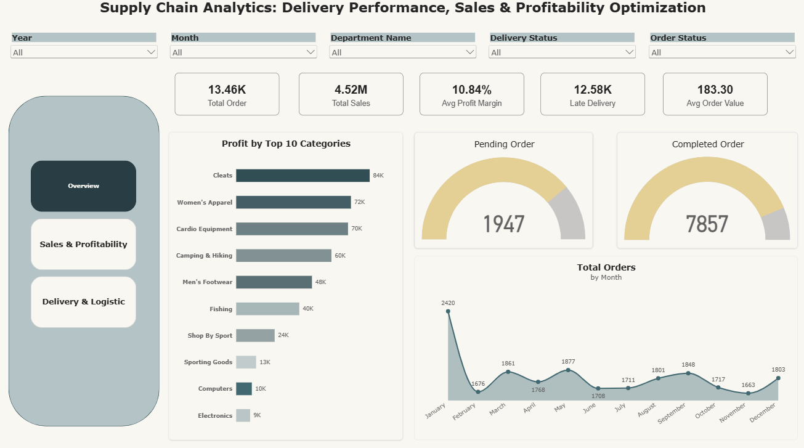
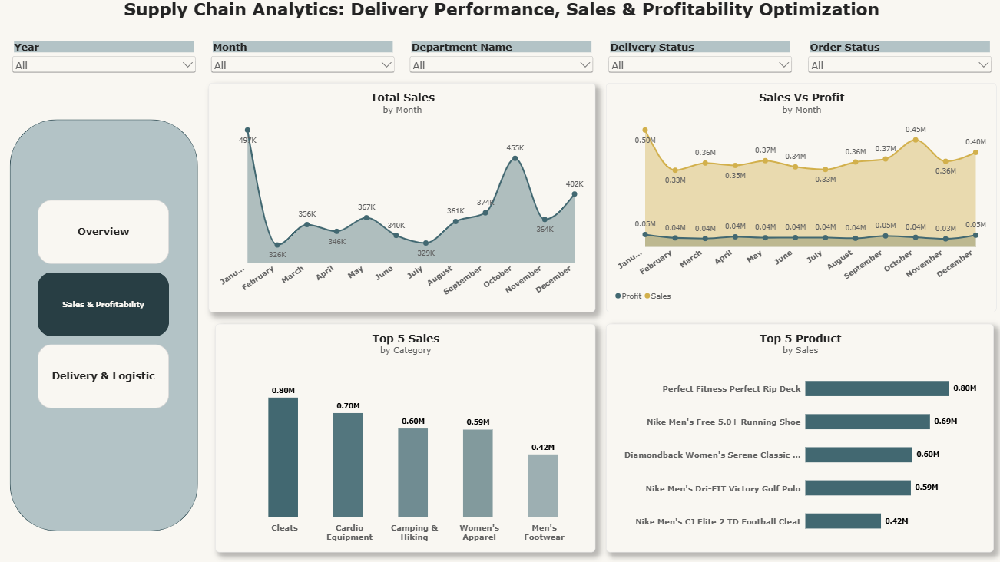
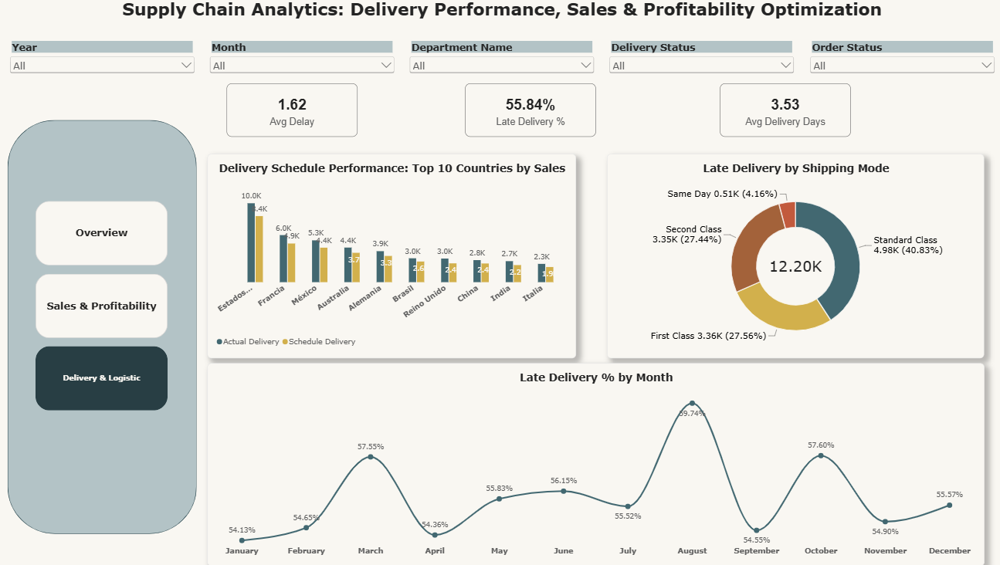

# Supply Chain Analytics: Delivery Performance, Sales & Profitability Optimization

## Project Overview
This project analyzes supply chain data to understand sales performance, profitability, delivery delays, product performance, and customer trends. Python is used for data cleaning, feature engineering, and exploratory data analysis (EDA), while Power BI is used to develop interactive dashboards and communicate business insights.

The goal is to transform raw supply chain data into meaningful insights that can support business decision-making and improve operational performance.

## Business Problem
Supply chain businesses need to monitor sales, profitability, and delivery performance to identify operational issues and improvement opportunities. However, raw transactional data can make it difficult to identify trends, understand the reasons behind late deliveries, and recognize profitable products or markets.

This project explores these challenges through data analysis and visualization.

## Project Objectives
- Analyze sales and profit trends over time.
- Evaluate overall delivery performance and identify late-delivery patterns.
- Identify products and product categories contributing to sales and profitability.
- Analyze the relationship between discounts, sales, and profit.
- Explore customer and geographic performance.
- Build interactive Power BI dashboards to present findings clearly.
- Provide data-driven recommendations to support business decisions.

## Tools and Technologies
- **Python:** Data analysis and data processing
- **Pandas:** Data cleaning, manipulation, and aggregation
- **NumPy:** Numerical operations and feature engineering
- **Matplotlib and Seaborn:** Exploratory data analysis and visualization
- **Power BI:** Interactive dashboards and business reporting
- **Jupyter Notebook / Google Colab:** Analysis environment
- **Git and GitHub:** Version control and project documentation

## Project Workflow
1. **Data Understanding:** Review the dataset structure, columns, data types, and data quality.
2. **Data Cleaning:** Check missing values, duplicate records, inconsistent data types, and invalid values.
3. **Feature Engineering:** Create useful analytical features such as order dates, delivery delays, delivery performance categories, and profit margin where valid.
4. **Exploratory Data Analysis:** Analyze sales, profitability, products, discounts, delivery performance, customers, and geographic trends.
5. **Power BI Dashboard Development:** Create interactive reports to summarize KPIs and business findings.
6. **Business Recommendations:** Translate the analysis into practical recommendations supported by the data.

## Repository Structure
```text
Supply-Chain-Analytics/
├── data/
│   └── README.md
├── notebooks/
│   ├── SupplyChainAnalytics.ipynb
├── powerbi/
│   └── README.md
├── outputs/
├── images/
├── Supply_Chain_Analytics_MDD.pdf
├── requirements.txt
└── README.md
```

## Key Business Questions
- How do sales and profit change over time?
- Which products and categories generate the highest sales and profit?
- How frequently are orders delivered late?
- Which regions or shipping methods show weaker delivery performance?
- How do discounts relate to profitability?
- Which customer segments or markets contribute most to business performance?
- What areas offer opportunities to improve operational efficiency?

## Power BI Dashboard Plan
The report is planned around the following pages:

1. **Executive Overview:** Key performance indicators, sales and profit trends, and delivery performance.
2. **Sales & Profitability:** Sales trends, profit analysis, product categories, and discount impact.
3. **Delivery & Logistics:** Late deliveries, scheduled versus actual shipping time, and shipping performance.

## Dashboard Images
 **Executive Overview:**

**Sales & Profitability:**

**Delivery & Logistics:**


## Key Performance Indicators (KPIs)
Potential KPIs include:
- Total Sales
- Total Profit
- Profit Margin
- Total Orders
- Average Order Value
- Late Delivery Rate
- Average Delivery Delay

KPI definitions and calculation levels will be validated against the dataset. Since one order may contain multiple item-level records, order-level and item-level measures will be handled carefully to avoid double-counting.

## Key Findings
*This section will be updated after completing the analysis.*

- Sales and profitability trends: To be determined.
- Top-performing products and categories: To be determined.
- Delivery performance patterns: To be determined.
- Discount and profitability relationship: To be determined.
- Geographic and customer insights: To be determined.

## Business Value
This project demonstrates how data analysis can help businesses:
- Monitor sales and profitability.
- Identify delivery performance issues.
- Understand product and market performance.
- Investigate potential relationships between discounts and profit.
- Communicate findings through interactive dashboards.
- Make informed decisions using data-driven recommendations.

## Data Quality and Limitations
- Data quality issues and missing values will be assessed during cleaning.
- Business conclusions will be based on validated calculations and observed patterns.
- Relationships between variables will not automatically be treated as evidence of causation.
- Delivery status, order-level metrics, and financial calculations will be checked before reporting.
- The dataset's source and licence should be reviewed before redistribution.

## How to Explore the Project
1. Open the notebooks in the `notebooks/` folder.
2. Run them in order, starting with data understanding and ending with EDA.
3. Review the analysis outputs and visualizations.
4. Open the Power BI report in the `powerbi/` folder when it is available.
5. Review the final findings and recommendations in this README.

**Note:** Place the dataset in the appropriate local folder before running the notebooks. Update file paths and install the required Python packages as needed.

## Author
**Rohit Vishwakarma**

Aspiring Data Analyst | Python | SQL | Power BI | Excel | Data Visualization

This project is part of my data analytics portfolio and demonstrates my approach to transforming data into actionable business insights.

---
If you find this project useful, feel free to explore the notebooks and dashboard.
